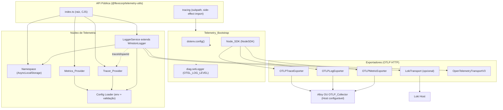
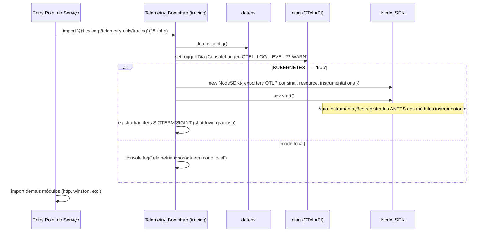

# Design Document

## Overview

A `@flexicorp/telemetry-utils` é uma biblioteca npm (CommonJS, Node >= 20) que unifica os três pilares de observabilidade — **logs**, **métricas** e **tracing** — em um único pacote reutilizável. O design preserva integralmente o comportamento do logger de referência `@engebras/lib-logger` (Winston estendido, com níveis e cores customizados, formatos de console estilizado/JSON, transporte Loki opcional e integração com OpenTelemetry via namespace `AsyncLocalStorage`) e generaliza o bootstrap de tracing de referência (`omnia-core/.../tracing/index.ts`) para um módulo de inicialização do SDK OpenTelemetry Node, importável por efeito colateral através de um subcaminho dedicado (`@flexicorp/telemetry-utils/tracing`).

### Objetivos de design e mapeamento para requisitos

| Objetivo de design | Requisito(s) |
| --- | --- |
| Reproduzir o Logger de referência (níveis, cores, formatos, filtragem por nível, resiliência de transporte) | R1 |
| Propagar contexto de requisição (Correlation_Id / keyId) via Namespace `AsyncLocalStorage` | R2 |
| Correlacionar logs e traces (injeção de `traceId`/`spanId`, `withTrace`) | R3 |
| Expor registro e exportação de métricas (counter/histogram/gauge) | R4 |
| Expor criação e exportação de spans de tracing | R5 |
| Permitir seleção de destino de exportação (`alloy` \| `otlp`) por sinal + transporte Loki | R6 |
| Configurar host e parâmetros via variáveis de ambiente com defaults e validação | R7 |
| Empacotar/distribuir como pacote npm (tsup cjs, dts, peerDependency `@opentelemetry/api`, Node >= 20) | R8 |
| Bootstrap do SDK na inicialização via subcaminho importável por efeito colateral | R9 |

### Decisões arquiteturais fundamentais

1. **Endpoints OTLP independentes por sinal** — traces, logs e métricas possuem endpoints próprios (`OTEL_EXPORTER_OTLP_{TRACES,LOGS,METRICS}_ENDPOINT`), não uma base URL única (R7.2, R9.4).
2. **Toggle de ativação do SDK via `KUBERNETES === 'true'`** — fora do Kubernetes, o SDK não é iniciado (modo local), apenas registra o skip no console (R9.4, R9.5).
3. **`Export_Target` selecionável entre `alloy` e `otlp` por sinal** — ambos os destinos falam OTLP HTTP; a única diferença é o host/endpoint de destino (o Alloy recebe OTLP nativamente). Logo, a seleção resolve apenas qual Host/endpoint é usado pelo exportador OTLP HTTP (R6.1–R6.3).

## Architecture

A biblioteca é organizada em três camadas: **API pública** (consumida pelo código da aplicação), **núcleo de telemetria** (componentes que implementam logs/métricas/traces) e **bootstrap** (inicialização do SDK por efeito colateral, carregado antes de qualquer módulo instrumentado).

### Diagrama de componentes



### Fluxo de inicialização

A ordem de carregamento é crítica: o bootstrap precisa executar antes de qualquer módulo instrumentado (ex.: `http`, `winston`) ser importado, para que as auto-instrumentações sejam aplicadas via monkey-patching (R9.11).



### Estrutura de pastas e módulos

```
telemetry-utils/
├── package.json              # exports: "." e "./tracing"; main cjs; types; files
├── tsup.config.mjs           # entry: index.ts + tracing/index.ts; format cjs; dts
├── tsconfig.json
├── src/
│   ├── index.ts              # ponto de entrada raiz: re-exporta API pública nomeada
│   ├── config/
│   │   └── env.ts            # Config Loader: leitura/validação de env vars + defaults
│   ├── logging/
│   │   ├── logger-service.ts # LoggerService extends WinstonLogger
│   │   ├── winston-logger.ts # WinstonLogger: níveis, cores, formatContext/formatPrint
│   │   └── namespace.ts      # Namespace (AsyncLocalStorage)
│   ├── metrics/
│   │   └── metrics-provider.ts
│   ├── tracing/
│   │   ├── index.ts          # Telemetry_Bootstrap (SUBPATH side-effect)
│   │   └── tracer-provider.ts
│   └── types.ts              # tipos compartilhados (ExportTarget, LogLevel, LogFormat, ...)
└── dist/                     # artefatos gerados (index.js, tracing/index.js, *.d.ts)
```

Separação clara entre:
- **`src/index.ts`** (raiz): exporta `LoggerService`, `Namespace`, `MetricsProvider`, `TracerProvider` como pontos de entrada nomeados (R8.5). **Não** importa o bootstrap, pois a importação da raiz não deve iniciar o SDK.
- **`src/tracing/index.ts`** (subpath `./tracing`): módulo de bootstrap importável por efeito colateral (R8.7, R9.11).

### Configuração do `package.json` (exports)

```json
{
  "name": "@flexicorp/telemetry-utils",
  "version": "1.0.0",
  "type": "commonjs",
  "main": "./dist/index.js",
  "types": "./dist/index.d.ts",
  "exports": {
    ".": {
      "require": "./dist/index.js",
      "types": "./dist/index.d.ts"
    },
    "./tracing": {
      "require": "./dist/tracing/index.js",
      "types": "./dist/tracing/index.d.ts"
    }
  },
  "files": ["dist", "README.md"],
  "engines": { "node": ">=20.0.0" }
}
```

## Components and Interfaces

### Config Loader (`src/config/env.ts`) — R7

Centraliza leitura, aplicação de defaults e validação das variáveis de ambiente. É consumido por `LoggerService`, `MetricsProvider`, `TracerProvider` e pelo bootstrap.

```typescript
export type ExportTarget = 'alloy' | 'otlp';
export type LogLevel = 'crit' | 'alert' | 'http' | 'error' | 'warn' | 'info' | 'debug' | 'verbose';
export type LogFormat = 'json' | 'text' | 'message';

export interface TelemetryConfig {
  applicationName: string;      // APPLICATION_NAME, default 'unknown-service' (R7.4)
  stage: string;                // APP_STAGE, default 'unknown-stage' (R7.5)
  serviceNamespace: string;     // SERVICE_NAMESPACE
  logLevel: LogLevel;           // LOG_LEVEL, default 'info' (R1.7, R1.8)
  logFormat: LogFormat;         // LOG_FORMAT, default 'text' (R1.9)
  lokiTransport: boolean;       // LOKI_TRANSPORT === 'true' (R6.6, R6.7)
  lokiHost: string;             // LOKI_HOST, default loki.infra... (R6.8)
  kubernetes: boolean;          // KUBERNETES === 'true' (R9.4, R9.5)
  otelLogLevel: string;         // OTEL_LOG_LEVEL, default 'WARN' (R9.2, R9.3)
  otlpEndpoints: {
    traces: string;   // OTEL_EXPORTER_OTLP_TRACES_ENDPOINT, default .../v1/traces (R7.3)
    logs: string;     // OTEL_EXPORTER_OTLP_LOGS_ENDPOINT, default .../v1/logs
    metrics: string;  // OTEL_EXPORTER_OTLP_METRICS_ENDPOINT, default .../v1/metrics
  };
  exportTargets: {
    metrics: ExportTarget; // (R6.1)
    traces: ExportTarget;
  };
}

/** Lê o ambiente, aplica defaults e valida. Lança erro descritivo em config inválida (R7.7). */
export function loadConfig(env?: NodeJS.ProcessEnv): TelemetryConfig;

/** Valida/normaliza Log_Level; valor inválido -> 'info' + log de erro no console (R1.8). */
export function resolveLogLevel(raw: string | undefined): LogLevel;

/** Valida/normaliza Log_Format; valor inválido/ausente -> 'text' (R1.9). */
export function resolveLogFormat(raw: string | undefined): LogFormat;

/** Valida Export_Target; valor inválido -> erro descritivo (R6.4). */
export function resolveExportTarget(raw: string | undefined, signal: 'metrics' | 'traces'): ExportTarget;
```

Observação sobre separação de responsabilidades: a validação de `LOG_LEVEL`/`LOG_FORMAT` é **tolerante** (faz fallback para o default e registra o problema — R1.8/R1.9), enquanto a validação de `Export_Target` e de valores de inicialização do SDK é **estrita** (rejeita com erro — R6.4/R7.7). Essa distinção reflete o nível de criticidade de cada parâmetro.

### WinstonLogger (`src/logging/winston-logger.ts`) — R1

Reproduz fielmente a classe de referência: níveis, cores, utilitários de formatação de contexto e impressão.

```typescript
export class WinstonLogger extends winston.Logger {
  static levels: AbstractConfigSetLevels; // crit:0 ... verbose:7 (R1.1)
  static colors: AbstractConfigSetColors; // cor por nível (R1.2)

  static parsePascalCase(label?: string): string | undefined;
  static concatMessageWithDataString(message: string, data: any): string;
  static transformArrayDataToObject(data?: null | any[]): object;
  static formatContext: winston.Logform.FormatWrap; // injeta correlationId/keyId do Namespace
  static formatPrint(stage: string): winston.Logform.Format; // console estilizado (R1.4)
  static ucFirst(label: string): string;
  static styled(color: keyof typeof logColors, message: string): string;
  static ExtendsNestLogger(controllerName?: string): NestLoggerAdapter;

  constructor(options: winston.LoggerOptions);
}
```

### LoggerService (`src/logging/logger-service.ts`) — R1, R3, R6

```typescript
export class LoggerService extends WinstonLogger {
  readonly logLevel: string;
  readonly stage: string;
  readonly service: string;

  constructor(
    context: string,
    logLevel?: LogLevel,     // default resolvido via Config Loader (R1.7)
    stage?: string,
    service?: string
  );

  /**
   * Executa fn dentro de um Span ativo nomeado.
   * Sucesso: encerra o span e retorna o valor (R3.3).
   * Exceção: recordException + status erro + encerra span + repropaga (R3.4).
   */
  withTrace<T>(name: string, fn: (span: Span) => Promise<T>): Promise<T>;
}
```

Comportamentos preservados da referência:
- Formato combinado: `otelFormat` (injeta `traceId`/`spanId` do span ativo — R3.1/R3.2) + `timestamp` + `json`; `defaultMeta: { service }` (R1.3).
- Transporte `OpenTelemetryTransportV3` no nível corrente.
- Console estilizado quando `LOG_FORMAT ∈ {text, message}` (R1.4) ou console JSON caso contrário (R1.5).
- `LokiTransport` adicionado apenas quando `LOKI_TRANSPORT === 'true'` (R6.6/R6.7), com `LOKI_HOST` ou default (R6.8).
- Listener `this.on('error', ...)` que registra no console de erro sem derrubar o processo (R1.10).

### Namespace (`src/logging/namespace.ts`) — R2

```typescript
export class Namespace {
  isActived(): boolean;                    // há escopo ativo? (R2.5)
  run(fn: () => void): void;               // cria escopo isolado (R2.1)
  setRequestId<T>(value: T): void;         // armazena no escopo ativo (R2.2, R2.6 no-op fora de escopo)
  getRequestId<T>(): T | null;             // lê do escopo ativo (R2.3, R2.7 -> null)
  setkeyId<T>(value: T): void;
  getkeyId<T>(): T | undefined;
}
export default new Namespace();
```

### Metrics_Provider (`src/metrics/metrics-provider.ts`) — R4, R6

Encapsula a API de métricas do OpenTelemetry (`@opentelemetry/api` `metrics`), cujos exportadores são configurados pelo bootstrap (`PeriodicExportingMetricReader`, intervalo de 60s — R4.3/R9.9).

```typescript
export type MetricKind = 'counter' | 'histogram' | 'gauge';

export interface MetricHandle {
  record(value: number, attributes?: Record<string, string | number | boolean>): void;
}

export class MetricsProvider {
  constructor(config: TelemetryConfig);

  /** Cria/obtém um contador (R4.1). */
  counter(name: string, options?: MetricOptions): MetricHandle;
  /** Cria/obtém um histograma (R4.1). */
  histogram(name: string, options?: MetricOptions): MetricHandle;
  /** Cria/obtém um gauge (R4.1). */
  gauge(name: string, options?: MetricOptions): MetricHandle;

  /**
   * Registro genérico por tipo. Tipo inválido -> erro descritivo (R4.6).
   */
  register(kind: MetricKind, name: string, options?: MetricOptions): MetricHandle;
}
```

O nome do serviço (`APPLICATION_NAME`) e o estágio (`APP_STAGE`) são atributos de recurso aplicados no `resource` do `Node_SDK` (R4.4), compartilhados entre métricas e traces.

### Tracer_Provider (`src/tracing/tracer-provider.ts`) — R5

```typescript
export class TracerProvider {
  constructor(config: TelemetryConfig);

  /** Cria um Span nomeado (nome com 1..255 chars). Fora de um span ativo -> span raiz (R5.1, R5.4). */
  startSpan(name: string, options?: SpanOptions): Span;

  /** Cria um span ativo e executa fn em seu contexto; vincula ao pai se houver (R5.4). */
  startActiveSpan<T>(name: string, fn: (span: Span) => T): T;
}
```

Atributos de recurso `service.name`/`APP_STAGE` aplicados via `resource` do SDK (R5.3). Encerramento do span dispara envio ao `Export_Target` de traces (R5.2); falha de envio é tratada pelo processador em lote do SDK, com log de erro e descarte do span sem interromper os demais (R5.5).

### Telemetry_Bootstrap (`src/tracing/index.ts`) — R9

Módulo sem exports nomeados obrigatórios (export default do `sdk` opcional para inspeção), executado por efeito colateral.

```typescript
// 1. dotenv primeiro (R9.1)
import * as dotenv from 'dotenv';
dotenv.config();

// 2. diag a partir de OTEL_LOG_LEVEL (R9.2/R9.3)
// 3. new NodeSDK({...}) + sdk.start() quando KUBERNETES === 'true' (R9.4)
//    - OTLPTraceExporter / OTLPLogExporter / OTLPMetricExporter (endpoints por sinal R9.4)
//    - resourceFromAttributes: service.name, service_namespace, deployment.environment (R9.8)
//    - BatchLogRecordProcessor (logs)
//    - getNodeAutoInstrumentations: winston habilitado (R9.6), http ignora /metrics (R9.7)
//    - RuntimeNodeInstrumentation (R9.6)
//    - PeriodicExportingMetricReader exportIntervalMillis 60000 (R9.9)
// 4. SIGTERM/SIGINT -> shutdown gracioso (R9.10)
// 5. KUBERNETES !== 'true' -> console.log skip (R9.5)
export default sdk; // NodeSDK | null
```

O `Export_Target` (`alloy` | `otlp`) é resolvido pelo Config Loader para selecionar o Host/endpoint de cada exportador OTLP HTTP (R6.2/R6.3): como ambos os destinos consomem OTLP, a seleção apenas direciona a URL do exportador.

## Data Models

### Variáveis de ambiente

| Variável | Consumidor | Default | Validação | Requisito |
| --- | --- | --- | --- | --- |
| `APPLICATION_NAME` | Logger, Metrics, Tracer, SDK | `unknown-service` | — | R7.1, R7.4 |
| `APP_STAGE` | Logger, Metrics, Tracer, SDK | `unknown-stage` | — | R7.1, R7.5 |
| `SERVICE_NAMESPACE` | SDK (resource) | `ecs` (sugerido) | — | R9.8 |
| `LOG_LEVEL` | Logger | `info` | conjunto de Log_Level; inválido -> `info` + erro console | R1.6, R1.7, R1.8 |
| `LOG_FORMAT` | Logger | `text` | `json`\|`text`\|`message`; inválido/ausente -> `text` | R1.4, R1.5, R1.9 |
| `LOKI_TRANSPORT` | Logger | ausente (desabilitado) | `true` habilita | R6.6, R6.7 |
| `LOKI_HOST` | Logger | `http://loki.infra.svc.cluster.local:3100` | — | R6.8 |
| `KUBERNETES` | Bootstrap | ausente (modo local) | `true` ativa SDK | R9.4, R9.5 |
| `OTEL_LOG_LEVEL` | Bootstrap (diag) | `WARN` | nível diag; inválido -> `WARN` | R9.2, R9.3 |
| `OTEL_EXPORTER_OTLP_TRACES_ENDPOINT` | Bootstrap/Tracer | `http://otel-collector.infra.svc.cluster.local:4318/v1/traces` | — | R7.2, R7.3 |
| `OTEL_EXPORTER_OTLP_LOGS_ENDPOINT` | Bootstrap | `http://otel-collector.infra.svc.cluster.local:4318/v1/logs` | — | R7.2, R7.3 |
| `OTEL_EXPORTER_OTLP_METRICS_ENDPOINT` | Bootstrap/Metrics | `http://otel-collector.infra.svc.cluster.local:4318/v1/metrics` | — | R7.2, R7.3 |
| `EXPORT_TARGET_TRACES` (sugerido) | Config | `otlp` | `alloy`\|`otlp`; inválido -> erro | R6.1, R6.4 |
| `EXPORT_TARGET_METRICS` (sugerido) | Config | `otlp` | `alloy`\|`otlp`; inválido -> erro | R6.1, R6.4 |

### Níveis de log (prioridade numérica — R1.1)

| Nível | Prioridade | Cor (R1.2) |
| --- | --- | --- |
| `crit` | 0 | `bold italic dim red` |
| `alert` | 1 | `bold cyan` |
| `http` | 2 | `bold blue` |
| `error` | 3 | `bold red` |
| `warn` | 4 | `yellow` |
| `info` | 5 | `green` |
| `debug` | 6 | `magenta` |
| `verbose` | 7 | `bold italic dim` |

Semântica de filtragem: um registro é emitido quando `prioridade(nível_registro) <= prioridade(LOG_LEVEL)`, onde `crit` (0) é a maior prioridade e `verbose` (7) a menor (R1.6).

### Registro de log emitido

Campos sempre presentes: `timestamp`, `level`, `service`, `message` (R1.3). Campos condicionais: `correlationId` e `keyId` quando há escopo de Namespace ativo (R2.4/R2.5); `traceId` e `spanId` quando há Span ativo (R3.1/R3.2).

### Atributos de recurso (resource) do Node_SDK

| Atributo | Origem | Requisito |
| --- | --- | --- |
| `service.name` | `APPLICATION_NAME` | R9.8, R4.4, R5.3 |
| `service_namespace` | `SERVICE_NAMESPACE` | R9.8 |
| `deployment.environment` | `APP_STAGE` | R9.8 |

## Correctness Properties

*Uma propriedade é uma característica ou comportamento que deve se manter verdadeiro em todas as execuções válidas de um sistema — essencialmente, uma afirmação formal sobre o que o sistema deve fazer. Propriedades servem como ponte entre especificações legíveis por humanos e garantias de correção verificáveis por máquina.*

A análise de prework abaixo classifica cada critério de aceitação testável e fundamenta as propriedades que seguem. Critérios de infraestrutura/configuração do SDK OpenTelemetry (ex.: wiring de exportadores, auto-instrumentações, intervalos periódicos) são tratados como INTEGRATION/SMOKE e não geram propriedades (ver Testing Strategy).

### Prework (resumo da classificação)

- **R1.1/R1.2 (níveis e cores)**: valores estruturais fixos → EXAMPLE/SMOKE (tabela estática).
- **R1.3 (campos obrigatórios)**: para qualquer registro, deve conter `timestamp`/`level`/`service`/`message` → PROPERTY.
- **R1.6/R1.7/R1.8 (filtragem por nível + default)**: para qualquer par (nível configurado, nível do registro), emitir sse prioridade do registro <= configurada → PROPERTY. Fallback de valor inválido → coberto por EDGE_CASE da mesma propriedade de resolução.
- **R1.4/R1.5/R1.9 (formato de saída)**: estilização visual é EXAMPLE; porém o truncamento do Correlation_Id (7 últimos chars, ou integral se <= 7) é lógica pura → PROPERTY. Resolução de `LOG_FORMAT` com fallback → PROPERTY.
- **R1.10 (resiliência de transporte)**: evento de erro não derruba o processo → EXAMPLE (mock de transporte que lança).
- **R2.1 (isolamento de escopo)**: para quaisquer escopos concorrentes, valores não vazam entre eles → PROPERTY.
- **R2.2/R2.3 (set/get dentro de escopo)**: round-trip set→get retorna o mesmo valor → PROPERTY.
- **R2.6/R2.7 (fora de escopo)**: set é no-op; get retorna indefinido/null → PROPERTY (edge dentro da mesma propriedade de ausência de escopo).
- **R2.4/R2.5 (campos condicionais no log)**: correlationId/keyId presentes sse escopo ativo → PROPERTY.
- **R3.1/R3.2 (traceId/spanId condicionais)**: presentes sse há span ativo → PROPERTY.
- **R3.3/R3.4 (withTrace sucesso/erro)**: sucesso retorna valor e encerra span; exceção é repropagada e span marcado erro → PROPERTY (sobre funções geradas que resolvem ou lançam).
- **R4.1/R4.6 (tipos de métrica)**: tipo válido cria handle; tipo inválido rejeita com erro → PROPERTY.
- **R4.2/R4.3/R4.4/R4.5 (agregação/export/atributos/falha)**: comportamento do SDK/exporter → INTEGRATION.
- **R5.1 (nome do span 1..255)**: validação de comprimento → PROPERTY (incl. edge 0 e 256).
- **R5.4 (vínculo pai/filho vs raiz)**: span criado dentro de ativo vincula ao pai; sem ativo é raiz → PROPERTY.
- **R5.2/R5.3/R5.5 (export/atributos/falha de envio)**: comportamento do SDK/exporter → INTEGRATION.
- **R6.1/R6.4 (Export_Target por sinal)**: valor válido aceito; inválido rejeitado com erro → PROPERTY.
- **R6.2/R6.3 (destino OTLP)**: seleção direciona host/endpoint → PROPERTY (resolução de endpoint efetivo por target).
- **R6.6/R6.7/R6.8 (Loki toggle/host)**: transporte presente sse `LOKI_TRANSPORT==='true'`; host default quando ausente → PROPERTY.
- **R7.1/R7.3/R7.4/R7.5 (defaults de env)**: para env ausente, aplicar default correspondente → PROPERTY.
- **R7.2 (endpoints independentes)**: cada sinal lê seu próprio endpoint → PROPERTY (independência).
- **R7.6 (aplicar config)**: wiring → INTEGRATION.
- **R7.7 (config inválida rejeita)**: valor inválido em parâmetro estrito → erro descritivo preservando estado não inicializado → PROPERTY.
- **R8.x (empacotamento)**: build/manifesto → SMOKE/INTEGRATION (ver Testing Strategy).
- **R9.4/R9.5 (toggle KUBERNETES)**: SDK inicia sse `KUBERNETES==='true'` → PROPERTY (sobre função de decisão pura).
- **R9.1/R9.2/R9.3/R9.6–R9.11**: ordem de import, diag, auto-instrumentação, intervalos, shutdown → INTEGRATION/SMOKE. (R9.2/R9.3 resolução do nível diag com fallback → PROPERTY.)

### Reflexão (consolidação de redundâncias)

- Campos condicionais de Namespace (R2.4/R2.5) e de tracing (R3.1/R3.2) permanecem **separados** por validarem fontes de contexto distintas.
- Resolução com fallback de `LOG_LEVEL` (R1.8), `LOG_FORMAT` (R1.9) e `OTEL_LOG_LEVEL` (R9.3) seguem o mesmo padrão metamórfico ("entrada válida é preservada; entrada inválida vira default") e são **consolidadas** na Propriedade 5.
- Defaults de env ausentes (R7.1/R7.3/R7.4/R7.5) são **consolidados** na Propriedade 12.
- Set/get do Namespace (R2.2/R2.3) é um round-trip que subsume checagens pontuais de armazenamento, consolidado na Propriedade 6.

### Property 1: Registro de log sempre contém campos obrigatórios

*Para qualquer* mensagem, nível válido e serviço, o registro de log emitido pelo Logger contém os campos `timestamp`, `level`, `service` e `message`.

**Validates: Requirements 1.3**

### Property 2: Filtragem por prioridade de nível

*Para qualquer* `LOG_LEVEL` configurado e qualquer nível de registro, o registro é emitido se e somente se a prioridade numérica do nível do registro for menor ou igual à prioridade numérica do `LOG_LEVEL` configurado (`crit`=0 … `verbose`=7).

**Validates: Requirements 1.1, 1.6, 1.7**

### Property 3: Truncamento do Correlation_Id

*Para qualquer* Correlation_Id, a representação exibida no formato estilizado é composta pelos últimos 7 caracteres quando o identificador possui mais de 7 caracteres, e pelo identificador integral quando possui 7 caracteres ou menos.

**Validates: Requirements 1.4**

### Property 4: Campos de correlação condicionados ao escopo de Namespace

*Para qualquer* registro de log, os campos `correlationId` e `keyId` estão presentes se e somente se existe um escopo de Namespace ativo com esses valores armazenados; na ausência de escopo ativo, o registro é emitido sem esses campos.

**Validates: Requirements 2.4, 2.5**

### Property 5: Resolução de configuração enumerada com fallback

*Para qualquer* valor de entrada de `LOG_LEVEL`, `LOG_FORMAT` ou `OTEL_LOG_LEVEL`, a resolução retorna o próprio valor quando ele pertence ao conjunto permitido e retorna o valor padrão correspondente (`info`, `text`, `WARN`) quando a entrada é inválida ou ausente.

**Validates: Requirements 1.8, 1.9, 9.3**

### Property 6: Round-trip de armazenamento do Namespace dentro de escopo

*Para qualquer* valor, quando armazenado via `setRequestId`/`setkeyId` dentro de um escopo ativo, uma leitura subsequente via `getRequestId`/`getkeyId` no mesmo escopo retorna um valor igual ao armazenado.

**Validates: Requirements 2.2, 2.3**

### Property 7: Isolamento entre escopos concorrentes do Namespace

*Para quaisquer* dois escopos criados por `run`, um valor armazenado em um escopo não é acessível a partir de outro escopo, e cada escopo observa apenas os valores nele armazenados.

**Validates: Requirements 2.1**

### Property 8: Operações do Namespace fora de escopo

*Para qualquer* valor, invocar `setRequestId`/`setkeyId` fora de um escopo ativo não armazena o valor e não interrompe a execução, e `getRequestId` fora de escopo (ou em escopo sem valor armazenado) retorna um valor indefinido.

**Validates: Requirements 2.6, 2.7**

### Property 9: Campos de tracing condicionados ao Span ativo

*Para qualquer* registro de log, os campos `traceId` e `spanId` estão presentes se e somente se existe um Span ativo no momento da emissão.

**Validates: Requirements 3.1, 3.2**

### Property 10: Semântica de sucesso e erro de `withTrace`

*Para qualquer* função assíncrona executada por `withTrace`, se a função resolve, o span é encerrado e o valor resolvido é retornado ao chamador; se a função lança, a mesma exceção é repropagada, o span é marcado com status de erro e encerrado.

**Validates: Requirements 3.3, 3.4**

### Property 11: Validação do tipo de métrica

*Para qualquer* identificador de tipo de métrica, o registro é aceito e produz um handle quando o tipo é `counter`, `histogram` ou `gauge`, e é rejeitado com erro descritivo quando o tipo não pertence a esse conjunto.

**Validates: Requirements 4.1, 4.6**

### Property 12: Aplicação de defaults de variáveis de ambiente

*Para qualquer* subconjunto de variáveis de ambiente ausentes dentre `APPLICATION_NAME`, `APP_STAGE` e os endpoints OTLP por sinal, a configuração resolvida aplica exatamente o valor padrão correspondente para cada variável ausente e preserva o valor fornecido para as presentes.

**Validates: Requirements 7.1, 7.3, 7.4, 7.5**

### Property 13: Independência dos endpoints OTLP por sinal

*Para qualquer* combinação de valores dos endpoints de traces, logs e métricas, a configuração resolvida de cada sinal reflete exclusivamente a variável de ambiente daquele sinal, sem interferência das demais.

**Validates: Requirements 7.2**

### Property 14: Validação estrita de Export_Target

*Para qualquer* valor de `Export_Target` por sinal, a configuração é aceita quando o valor é `alloy` ou `otlp`, e é rejeitada com erro descritivo (preservando o estado não inicializado) quando o valor é qualquer outro.

**Validates: Requirements 6.1, 6.4, 7.7**

### Property 15: Resolução do host efetivo por Export_Target

*Para qualquer* sinal exportável e `Export_Target` válido, o host/endpoint efetivo resolvido para o exportador OTLP HTTP corresponde ao Host associado ao destino selecionado (`alloy` ou `otlp`).

**Validates: Requirements 6.2, 6.3**

### Property 16: Presença condicional do transporte Loki

*Para qualquer* configuração, o transporte Loki é adicionado ao Logger se e somente se `LOKI_TRANSPORT === 'true'`, e o host utilizado é o valor de `LOKI_HOST` quando definido ou o host padrão `http://loki.infra.svc.cluster.local:3100` quando ausente.

**Validates: Requirements 6.6, 6.7, 6.8**

### Property 17: Validação do comprimento do nome do Span

*Para qualquer* string de nome de operação, a criação do Span é aceita quando o comprimento está entre 1 e 255 caracteres (inclusive) e rejeitada quando o comprimento é 0 ou superior a 255.

**Validates: Requirements 5.1**

### Property 18: Vínculo de contexto pai/filho de Spans

*Para qualquer* criação de Span, quando existe um Span ativo o novo Span é vinculado ao Trace_Context do pai (compartilhando o mesmo `traceId`); na ausência de Span ativo, o novo Span é criado como raiz de um novo Trace_Context.

**Validates: Requirements 5.4**

### Property 19: Decisão de ativação do SDK por `KUBERNETES`

*Para qualquer* valor da variável de ambiente `KUBERNETES`, a decisão de iniciar o Node_SDK é verdadeira se e somente se o valor é exatamente `true`; para qualquer outro valor (ausente ou diferente), o SDK não é iniciado e o modo local é registrado.

**Validates: Requirements 9.4, 9.5**

## Error Handling

| Cenário | Comportamento | Requisito |
| --- | --- | --- |
| Erro em transporte de log (ex.: Loki/OTLP indisponível) | Listener `on('error')` registra no console de erro e o processo continua emitindo os demais registros | R1.10 |
| `LOG_LEVEL` inválido | Fallback para `info` + mensagem no console de erro indicando o valor inválido | R1.8 |
| `LOG_FORMAT` inválido/ausente | Fallback silencioso para o formato estilizado `text` | R1.9 |
| `OTEL_LOG_LEVEL` inválido/ausente | Fallback para nível diag `WARN` | R9.2, R9.3 |
| Tipo de métrica inválido | `register` rejeita com erro descritivo identificando o tipo | R4.6 |
| Falha de exportação de métricas | Erro registrado; métricas agregadas retidas; retransmissão no próximo intervalo (60s) | R4.5 |
| Falha de envio de Span | Erro no console de erro; span descartado; processamento dos demais spans continua | R5.5 |
| Exceção dentro de `withTrace` | `recordException` + status erro no span + encerramento + repropagação | R3.4 |
| Falha genérica de transmissão ao Export_Target | Erro no console de erro; sinais pendentes preservados; processo não encerra | R6.5 |
| `Export_Target` inválido | Rejeição na inicialização com erro descritivo; exportador correspondente não inicializado | R6.4 |
| Config de inicialização inválida | Rejeição da inicialização com erro descritivo (parâmetro + valor); estado não inicializado preservado | R7.7 |
| Node.js < 20 na instalação | Aviso de incompatibilidade indicando a versão mínima exigida (via `engines`/warning) | R8.4 |
| `SIGTERM`/`SIGINT` | Shutdown gracioso do Node_SDK antes de encerrar o processo | R9.10 |

**Princípio geral de resiliência**: falhas de telemetria (export, transporte) nunca derrubam a aplicação hospedeira. Erros de configuração **estritos** (Export_Target, inicialização do SDK) são fail-fast com mensagem descritiva; erros de configuração **tolerantes** (LOG_LEVEL/LOG_FORMAT/OTEL_LOG_LEVEL) fazem fallback para defaults seguros.

## Testing Strategy

### Abordagem dupla

- **Testes unitários (example-based)**: exemplos concretos, casos de borda e condições de erro — níveis/cores estáticos (R1.1/R1.2), estilização visual de console (R1.4/R1.5), resiliência de transporte com mocks que lançam (R1.10), shutdown em sinais (R9.10).
- **Testes de propriedade (property-based)**: propriedades universais sobre lógica pura — ver Correctness Properties (Properties 1–19).
- **Testes de integração**: comportamento do SDK OpenTelemetry e exportadores, com 1–3 exemplos representativos — agregação/export de métricas (R4.2/R4.3/R4.4/R4.5), envio/atributos de spans (R5.2/R5.3/R5.5), wiring de config no SDK (R7.6), auto-instrumentações e ignore de `/metrics` (R9.6/R9.7), ordem de import e start antes de módulos instrumentados (R9.11).
- **Smoke tests**: artefatos de build e manifesto — gera CJS carregável via `require` (R8.1), peerDependency `@opentelemetry/api` ausente do bundle (R8.2), `engines.node >= 20.0.0` (R8.3), exports nomeados da raiz (R8.5), `.d.ts` por ponto de entrada (R8.6), subpath `./tracing` importável (R8.7).

### Por que PBT se aplica (e onde não)

PBT é aplicável porque a biblioteca contém lógica pura substancial com propriedades universais: filtragem por nível, truncamento de Correlation_Id, resolução de config com fallback, isolamento/round-trip do Namespace, validação de tipos de métrica, validação de nome de span e decisão de ativação do SDK. PBT **não** é aplicável à camada de I/O do OpenTelemetry (exportação real, instrumentação, agregação periódica) nem ao empacotamento — essas usam integração/smoke, conforme a tabela acima.

### Configuração dos testes de propriedade

- Biblioteca de PBT para TypeScript: **fast-check** (não implementar PBT do zero).
- Mínimo de **100 iterações** por teste de propriedade.
- Cada teste de propriedade implementa uma única propriedade e referencia a propriedade de design via comentário com a tag:
  - Formato: **Feature: telemetry-utils, Property {número}: {texto da propriedade}**
- Dependências de I/O (OTel SDK, transportes) mockadas nos testes de propriedade para isolar a lógica.

### Build e empacotamento (R8)

- **tsup** com múltiplos entry points: `src/index.ts` (raiz) e `src/tracing/index.ts` (subpath `./tracing`).
- `format: ['cjs']`, `target: 'node20'`, `dts: true`, `clean: true`, `sourcemap: true`, `splitting: false`, `shims: true`.
- `external`: `winston`, `winston-loki`, `@opentelemetry/api`, `@opentelemetry/sdk-node`, `@opentelemetry/auto-instrumentations-node` e demais pacotes OTel, mantendo-os fora do bundle.
- `engines.node >= 20.0.0` e `exports` com subcaminho `./tracing`.

### Dependências sugeridas

| Pacote | Classificação | Justificativa |
| --- | --- | --- |
| `@opentelemetry/api` | peerDependency | Interface compartilhada; não deve ser duplicada no bundle (R8.2) |
| `winston` | dependency | Núcleo do Logger de referência |
| `winston-loki` | dependency | Transporte Loki opcional (R6.6) |
| `@opentelemetry/winston-transport` | dependency | Transporte OpenTelemetry para logs do Winston |
| `@opentelemetry/sdk-node` | dependency | Node_SDK do bootstrap (R9) |
| `@opentelemetry/auto-instrumentations-node` | dependency | Auto-instrumentações (winston, http) (R9.6/R9.7) |
| `@opentelemetry/instrumentation-runtime-node` | dependency | Instrumentação de runtime (R9.6) |
| `@opentelemetry/exporter-trace-otlp-http` | dependency | Exportador OTLP de traces (R9.4) |
| `@opentelemetry/exporter-logs-otlp-http` | dependency | Exportador OTLP de logs (R9.4) |
| `@opentelemetry/exporter-metrics-otlp-http` | dependency | Exportador OTLP de métricas (R9.4) |
| `@opentelemetry/sdk-metrics` | dependency | `PeriodicExportingMetricReader` (R9.9) |
| `@opentelemetry/sdk-logs` | dependency | `BatchLogRecordProcessor` (R9.4) |
| `@opentelemetry/resources` | dependency | `resourceFromAttributes` (R9.8) |
| `dotenv` | dependency | Carregamento de env no bootstrap (R9.1) |
| `tsup`, `typescript`, `@types/node`, `fast-check`, `vitest` | devDependency | Build, tipos e testes (unit + PBT) |
